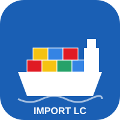
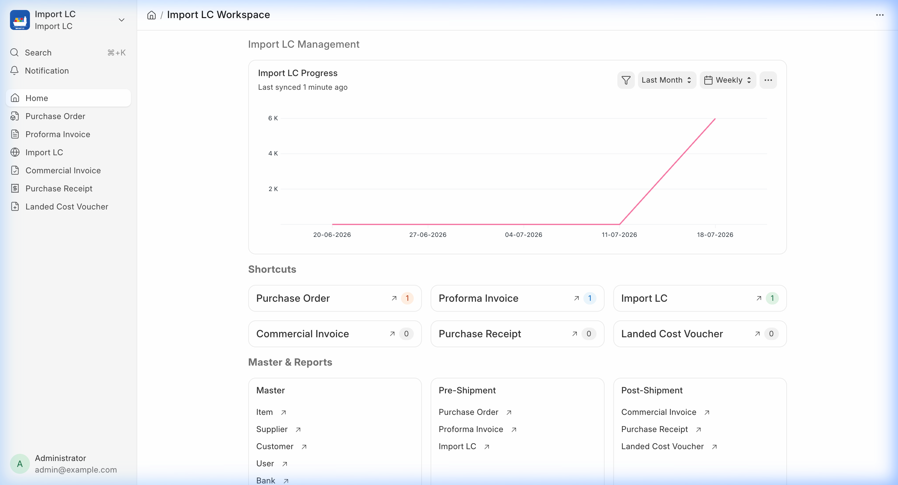
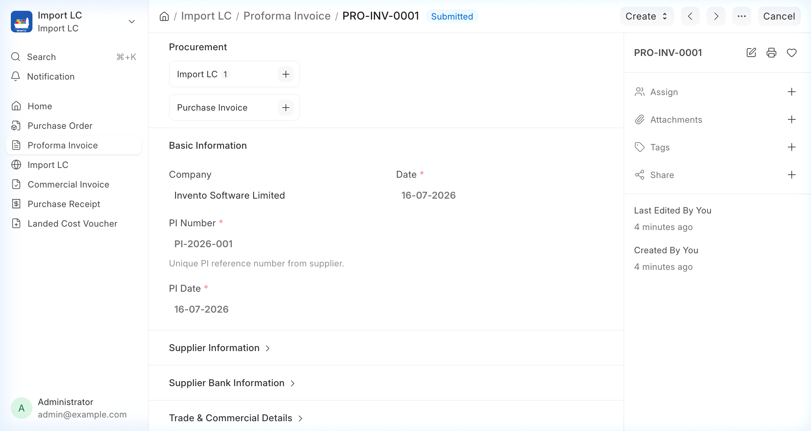
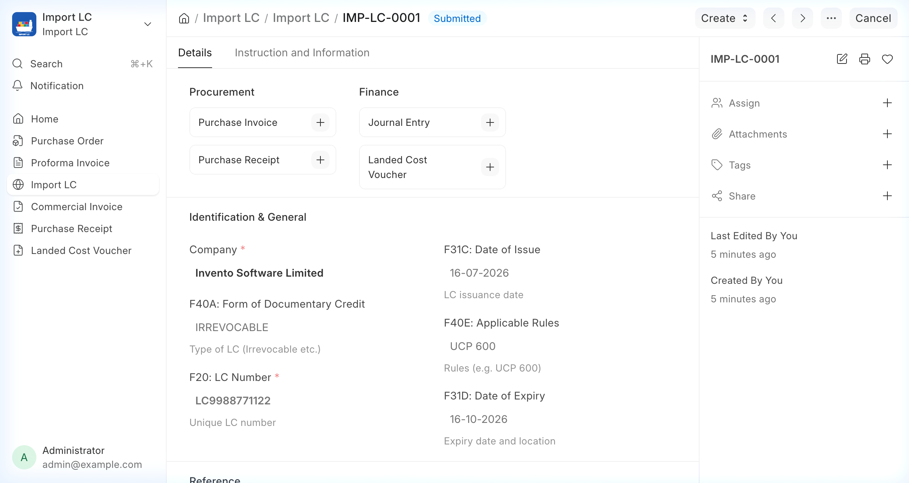

<div align="center">



# Import LC for ERPNext

**Import letter of credit management for ERPNext v16—from purchase order to landed cost.**

[](https://github.com/invento-software-limited/import-lc/actions/workflows/ci.yml)
[](https://github.com/invento-software-limited/import-lc/actions/workflows/linters.yml)
[](https://github.com/frappe/erpnext)
[](license.txt)

[Marketplace](https://cloud.frappe.io/marketplace/apps/import_lc) · [Documentation](https://invento-software-limited.github.io/import-lc/) · [LC management guide](https://invento.com.bd/import-export-lc-management-erpnext/) · [Export LC companion app](https://github.com/invento-software-limited/export-lc)

</div>



## See every import credit in the same system as purchasing and accounts

ERPNext manages purchase orders, receipts, invoices and accounting. Import LC adds the documentary-credit record between those steps, so teams can keep commercial terms, bank fields and landed-cost inputs together instead of rebuilding the same information across spreadsheets and files.

> **Scope:** Import LC records and maps LC data inside ERPNext. It does not connect to a bank, transmit SWIFT messages or replace bank approval and document-checking procedures.

## Import LC workflow at a glance

```text
Purchase Order
      │
      ▼
Import Proforma Invoice
      │
      ▼
Import LC ─────► Journal Entry for LC margin or expense
      │
      ├────────► Purchase Invoice
      └────────► Purchase Receipt ─────► Landed Cost Voucher
```

## What teams can do

| Task | How Import LC helps |
| --- | --- |
| Start from approved purchasing data | Create an **Import Proforma Invoice** from a Purchase Order and carry forward items, currency and commercial details. |
| Maintain the documentary credit | Record the Import LC with applicant, beneficiary, bank, value, dates, tolerance and shipment/document terms. |
| Post finance entries | Prepare Journal Entries for LC margin and LC-related expenses from the Import LC. |
| Continue procurement | Create a Purchase Invoice or Purchase Receipt from the Import LC instead of re-entering the transaction. |
| Build landed cost | Create a Landed Cost Voucher using submitted Purchase Receipts plus freight, insurance and LC-related charges. |
| Review activity visually | Use the Import LC workspace, shortcuts and progress chart for a faster operational view. |

## Familiar MT700-aligned fields

The Import LC form includes commonly used documentary-credit fields such as reference number (F20), issue and expiry dates (F31C/F31D), credit form (F40A/F40E), applicant and beneficiary (F50/F59), tolerance (F39A), partial shipment and transshipment (F43P/F43T), latest shipment date (F44C), goods and documents (F45A/F46A), additional conditions (F47A), charges (F71D) and instructions (F78).

These fields help structure LC information; they do not claim automatic SWIFT MT700 generation or transmission.

## Product screenshots

| Import Proforma Invoice | Import LC record |
| --- | --- |
|  |  |

## Import or export—which app do you need?

| Use case | App |
| --- | --- |
| You open an LC to buy goods, materials or machinery from a supplier | **Import LC** (this repository) |
| A buyer opens an LC in your favour and you ship against it | [**Export LC**](https://github.com/invento-software-limited/export-lc) |

Businesses that handle both directions can install both apps. In the current `version-16` repositories, the apps manage their respective workflows; they do not automatically create a master export LC/back-to-back import LC relationship across apps.

For the business context, terminology and process gaps these apps address, read [Import and Export LC Management in ERPNext](https://invento.com.bd/import-export-lc-management-erpnext/).

## Installation

### Frappe Cloud

Install [Import LC from the Frappe Marketplace](https://cloud.frappe.io/marketplace/apps/import_lc).

### Self-hosted bench

Use an existing Frappe/ERPNext v16 bench:

```bash
bench get-app https://github.com/invento-software-limited/import-lc.git --branch version-16
bench --site your-site.example install-app import_lc
bench --site your-site.example migrate
bench build --app import_lc
```

Open the app from the ERPNext app switcher after installation. For a fresh bench or site, follow the [official Frappe installation guide](https://frappeframework.com/docs/user/en/installation) first.

## Requirements and compatibility

| Component | Supported version |
| --- | --- |
| Frappe Framework | `>=16.0.0-dev, <17.0.0-dev` |
| ERPNext | v16 |
| Python | 3.10 or newer |
| App branch | `version-16` |

## Documentation and support

- [User guide](docs/user_guide.md)
- [Product overview](docs/product_overview.md)
- [Published documentation](https://invento-software-limited.github.io/import-lc/)
- [Report a reproducible issue](https://github.com/invento-software-limited/import-lc/issues)

When reporting a problem, include your Frappe and ERPNext versions, the affected document type, steps to reproduce and a redacted screenshot where useful. Never include LC numbers, bank credentials or confidential trade documents in a public issue.

## Contributing

Contributions are welcome. Install the repository's pre-commit hooks before opening a pull request:

```bash
cd apps/import_lc
pre-commit install
pre-commit run --all-files
```

The project uses Ruff, ESLint, Prettier and Semgrep alongside its CI checks.

## Publisher

Built and maintained by [Invento Software Limited](https://invento.com.bd/), an ERPNext partner in Bangladesh.

## License

MIT. See [license.txt](license.txt).
